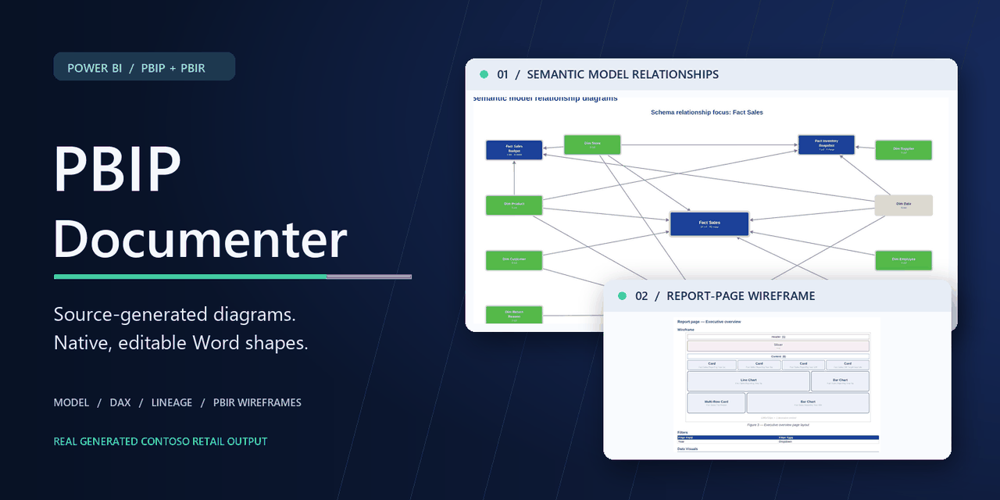
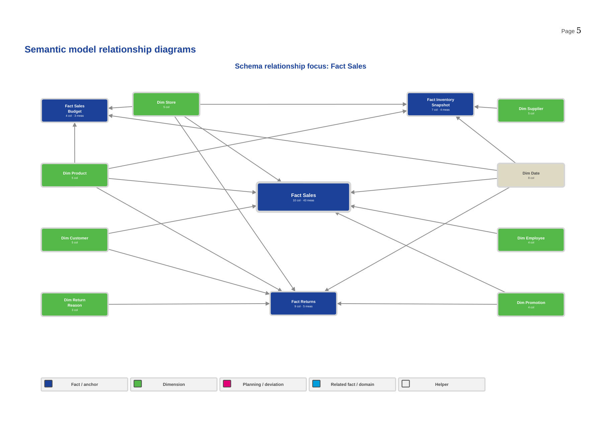
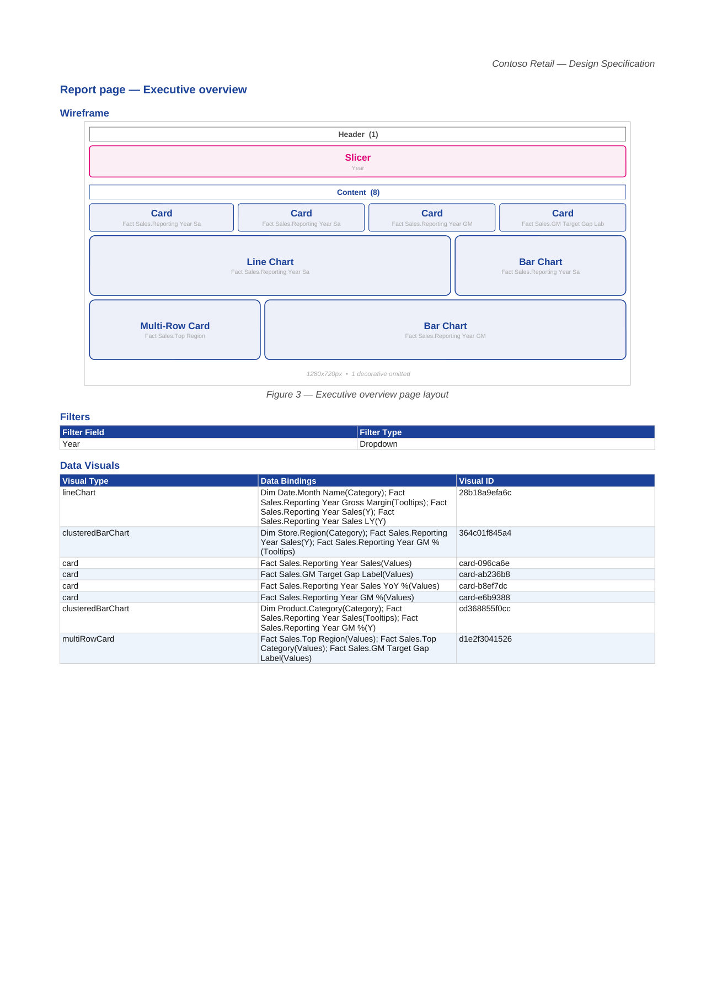
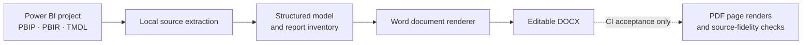

<p align="center">
  
</p>

<p align="center">
  <a href="https://github.com/analienx/pbidocumenter/actions/workflows/ci.yml"></a>
  <a href="https://pypi.org/project/pbip-documenter/"></a>
  <a href="https://pypi.org/project/pbip-documenter/"></a>
  <a href="LICENSE"></a>
</p>

<p align="center">
  <strong>Turn Power BI project files into documentation an engineer can actually review.</strong>
</p>

<p align="center">
  <a href="#get-started">Get started</a> ·
  <a href="#see-the-real-output">See the actual output</a> ·
  <a href="docs/AGENT_WORKFLOW.md">Run with an AI agent</a> ·
  <a href="docs/ARCHITECTURE.md">Explore the architecture</a>
</p>

---

## One input. A complete technical story.

Point **PBIP Documenter** at a Power BI Project (PBIP/PBIR with its semantic model) and generate a styled, editable **Microsoft Word design specification**. It reads local source files; it does not need to open Power BI Desktop, connect to a tenant or mutate the report for the core documentation workflow.

| From your PBIP source | Inside the Word specification |
| :--- | :--- |
| Semantic model / TMDL | Table and column inventories, measures, relationships, partitions and roles |
| DAX and Power Query | Calculation summaries and, in full mode, detailed DAX/M source |
| PBIR report definition | Pages, visuals, filter/binding inventories and report-page wireframes |
| Model structure | Visual relationship and lineage diagrams |
| Extracted metadata | Reviewable technical observations, support sections and owner-confirmation prompts |

**The important distinction:** extracted technical facts are not the same as business requirements. The document marks assumptions, business scope and ownership information that cannot be proven from PBIP source as items to confirm.

## See the real output

These are **actual screenshots of the generated Contoso Retail documentation**, not dashboard mockups. The public fictional PBIP sample is bundled under [`examples/contoso-retail`](examples/contoso-retail). Its Word files were produced by the installed-package GitHub CI job and rendered to PDF for visual review.

| Semantic-model relationship diagram | Report-page wireframe + inventory |
| :---: | :---: |
| [](docs/images/showcase/model-lineage.jpg) | [](docs/images/showcase/report-wireframe.jpg) |
| *Source-derived model relationships* | *Generated wireframe, not a Power BI Desktop screenshot* |

<p align="center">
  <a href="docs/EXAMPLES.md"><strong>View the full, annotated screenshot gallery →</strong></a>
</p>

The sample's checked inventory contains **12 tables · 55 measures · 19 relationships · 5 report pages · 54 visuals**. CI produces both concise and full specifications and checks those objects against the source project. See [the successful source-bound validation run](https://github.com/analienx/pbidocumenter/actions/runs/40870433647) and the [image provenance manifest](docs/images/showcase-provenance.json).

## Get started

**1. Install**

```bash
pipx install pbip-documenter
```

You can also use `python -m pip install pbip-documenter`. Python 3.10–3.13 are tested by the project.

**2. Generate a Word specification**

```bash
# Document the included fictional example (from a repository checkout)
pbip-documenter examples/contoso-retail --mode full --output contoso-retail.docx
```

Or point it at your own PBIP project directory:

```bash
pbip-documenter path/to/YourProject --mode full --output YourProject-spec.docx
```

**3. Open the resulting `.docx` in Word.** The current source version provides an immediately usable, linked contents page. `--mode default` creates a concise specification; `--mode full` includes expanded technical detail. Without `--output`, documents are saved under `Exported Documents/<ProjectName>/` in the current working directory.

> **Version note:** The screenshots here are generated from the repository's `main` revision (commit `ac6700c`). The PyPI release may lag behind `main`; install from the source repository when you specifically need the newest unreleased changes.

## Built for AI-assisted workflows

You do not need a special agent plugin to generate the document. An agent with terminal access can run the CLI, inspect the result and identify fields requiring owner input.

```text
Document this Power BI PBIP project with PBIP Documenter.
Run --mode full, write the DOCX to a dedicated output path,
verify the process succeeded, and report the extracted
tables, measures, relationships and pages.
Identify suggested text that requires business-owner confirmation.
Do not modify source PBIP files or invent business requirements.
```

The [agent runbook](docs/AGENT_WORKFLOW.md) covers repeatable invocation, safe paths, result checks and handoff. Power BI *visual-quality repair* is a different task; [VQS is an optional integration](docs/VQS_OPTIONAL.md), **never required to generate Word documentation**.

## How it works



The implementation is intentionally local-first: extraction in [`copiloter.py`](copiloter.py), document orchestration in [`document_service.py`](pbip_documenter/services/document_service.py), reusable Word components in [`docx_render/`](pbip_documenter/docx_render/), and [installed-wheel/rendered-page acceptance](.github/workflows/ci.yml) on GitHub runners.

[Read the architecture and trust boundaries](docs/ARCHITECTURE.md).

## Documentation

| I want to… | Start here |
| :--- | :--- |
| See **actual Word page screenshots** | [Output gallery and provenance](docs/EXAMPLES.md) |
| Find command options and output behavior | [CLI reference](docs/CLI.md) |
| Delegate documentation to an AI agent | [Agent workflow](docs/AGENT_WORKFLOW.md) |
| Understand the components and their boundaries | [Architecture](docs/ARCHITECTURE.md) |
| Connect optional inventory and matching sources | [Advanced inventory guide](docs/INVENTORY.md) |
| Review changes and contribute | [Changelog](CHANGELOG.md) · [Contributing](CONTRIBUTING.md) |

## Privacy, limitations and contribution

- **Source stays local for the core workflow.** PBIP Documenter reads project files and writes Word output without rewriting the report. Optional Jira, Power BI and other augmentation paths are separate, opt-in integrations that can require credentials.
- **No fabricated business context.** Confirm ownership, scope, classification, security context and operational SLAs with their source owners.
- **Rendered page acceptance is not Word-exact certification.** CI uses LibreOffice PDFs for repeatable visual evidence; Microsoft Word may paginate differently.
- **Use synthetic examples in public.** Never commit customer reports, generated client documents, tokens, caches or confidential screenshots.

Contributions are welcome through [issues](https://github.com/analienx/pbidocumenter/issues) and [pull requests](https://github.com/analienx/pbidocumenter/pulls). Read [contributing](CONTRIBUTING.md), [support](SUPPORT.md), [security reporting](SECURITY.md) and the [Apache-2.0 license](LICENSE).
