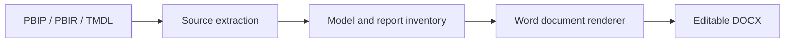

<p align="center">
  
</p>

<h1 align="center">PBIP Documenter</h1>
<p align="center"><strong>Turn Power BI project files into useful, editable Word documentation.</strong></p>
<p align="center">
  <a href="https://github.com/analienx/pbidocumenter/actions/workflows/ci.yml"></a>
  <a href="https://pypi.org/project/pbip-documenter/"></a>
  <a href="LICENSE"></a>
</p>
<p align="center">
  <a href="#try-it-in-two-commands">Get started</a> &nbsp;·&nbsp;
  <a href="#explore-an-actual-generated-document">Explore real output</a> &nbsp;·&nbsp;
  <a href="docs/AGENT_WORKFLOW.md">Use with an AI agent</a> &nbsp;·&nbsp;
  <a href="docs/ARCHITECTURE.md">Architecture</a>
</p>

---

## The documentation you wish every Power BI report came with

Give PBIP Documenter a local **PBIP/PBIR project**. It reads the semantic model and report definition, then builds a structured Microsoft Word specification—with **model relationships, DAX, Power Query, report-page wireframes and handover details**. No tenant connection or Power BI Desktop interaction is required for the core workflow.

## Explore an actual generated document

Open the complete example before installing anything. All three files were generated from the **fictional Contoso Retail PBIP project** and checked in so the proof doesn't expire with a CI artifact.

| Preview | Download the editable file |
| :-- | :-- |
| **[View the full 27-page specification (PDF)](docs/samples/Contoso-Retail-full.pdf)** | **[Full technical specification (.docx)](docs/samples/Contoso-Retail-full.docx)** |
| [Browse all seven full-page screenshots](docs/EXAMPLES.md) | [Concise 18-page specification (.docx)](docs/samples/Contoso-Retail-concise.docx) |

| **Semantic-model relationships** | **Report-page layout and bindings** |
| :--: | :--: |
| [](docs/images/showcase/model-lineage.jpg) | [](docs/images/showcase/report-wireframe.jpg) |
| *Actual DOCX output · model lineage* | *Actual DOCX output · PBIR wireframe, not a live dashboard screenshot* |

<sub>Source-based acceptance for this example: **12 tables · 55 measures · 19 relationships · 5 pages · 54 visuals**. Crops above come directly from the original generated document pages. [Source and screenshot evidence](docs/EXAMPLES.md#what-was-independently-checked) · [File checksums](docs/samples/README.md).</sub>

## Try it in two commands

```bash
pipx install pbip-documenter
pbip-documenter "/path/to/YourProject" --mode full --output design-specification.docx
```

That's it: open the editable `design-specification.docx` in Word. Prefer a shorter document? Omit `--mode full`. Prefer multiple projects? Omit `--output`; each valid project gets its own Word file under `Exported Documents/` in your working directory.

**Trying the sample?** Clone this repository and substitute `examples/contoso-retail` for the project path. The sample PBIP is in the Git checkout, **not installed by pipx**. [Full CLI reference](docs/CLI.md).

> **Version clarity:** This README reflects GitHub `main`. The latest PyPI release may not include every unreleased feature illustrated here. To reproduce the exact checked-in sample, use the [source revision and CI evidence](docs/samples/README.md).

## What you get

| Document section | Based on |
| :-- | :-- |
| **Model & data architecture** — tables, columns, measures, relationships, partitions, roles and lineage | TMDL and model files |
| **Calculations & transformations** — DAX inventories, plus full-code detail in full mode | DAX and Power Query / M |
| **Report design** — page layouts, visual types, filters, bookmarks and bindings | PBIR report definition |
| **Operations & handover** — support structure, technical observations and explicit confirmation fields | Extracted facts + labeled suggestions |

**No invented business requirements.** Project source alone cannot establish purpose, owner, classification, refresh SLA or real tenant access. The generated specification distinguishes extracted evidence from items to confirm.

## Built for developers and AI agents

Any agent with approved terminal access can run the same CLI, inspect the resulting DOCX, compare its inventories to the source and hand it to a human reviewer. No agent-specific account or VQS integration is required.

```text
Generate a full PBIP Documenter specification for this project.
Keep the source read-only. Verify the DOCX output and source inventories.
Flag assumptions and missing owner details; do not invent requirements.
Return the exact document path and any limitations.
```

[Copy the complete agent workflow](docs/AGENT_WORKFLOW.md) · [See the simple architecture](docs/ARCHITECTURE.md)

## How it works



Core generation is **local and read-only**. GitHub CI separately exercises the **installed wheel**, compares source inventories and renders documents to PDF for page-level evidence. The PDF renderer is LibreOffice, so it does **not** certify exact Microsoft Word pagination. [Architecture, trust boundaries and acceptance](docs/ARCHITECTURE.md).

### Go further

| Using the tool | Understanding or contributing |
| :-- | :-- |
| [Real Word output gallery](docs/EXAMPLES.md) | [Architecture and components](docs/ARCHITECTURE.md) |
| [AI-agent runbook](docs/AGENT_WORKFLOW.md) | [Contributing](CONTRIBUTING.md) |
| [CLI reference](docs/CLI.md) | [Changelog](CHANGELOG.md) |
| [Optional inventory enrichment](docs/INVENTORY.md) | [Security](SECURITY.md) and [support](SUPPORT.md) |

**Privacy first:** don't commit customer PBIP projects, credentials, caches or generated client documents. Use the fictional public sample for demonstrations. [VQS](docs/VQS_OPTIONAL.md) is an optional, separate Power BI *visual-quality* workflow—not a prerequisite or Word-quality gate.

<sub>Apache-2.0 · [License](LICENSE) · [Issues](https://github.com/analienx/pbidocumenter/issues) · [Pull requests](https://github.com/analienx/pbidocumenter/pulls)</sub>
