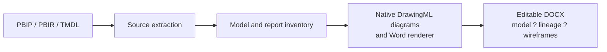

<p align="center">
  
</p>

<p align="center"><strong>Generate complete Power BI specifications with editable native Word diagrams ? not flattened pictures.</strong></p>
<p align="center">
  <a href="https://github.com/analienx/pbidocumenter/actions/workflows/ci.yml"></a>
  <a href="LICENSE"></a>
</p>
<p align="center">
  <a href="#try-it-in-two-commands">Get started</a> &nbsp;·&nbsp;
  <a href="#explore-an-actual-generated-document">Explore real output</a> &nbsp;·&nbsp;
  <a href="docs/AGENT_WORKFLOW.md">Use with an AI agent</a> &nbsp;·&nbsp;
  <a href="docs/ARCHITECTURE.md">Architecture</a>
</p>

---

## Reverse-engineer Power BI into editable technical documentation

Point PBIP Documenter at a local **PBIP / PBIR / TMDL project**. It reads the semantic model and report structure, then builds a Word specification with **diagrams generated from your actual source**. No Power BI Desktop or tenant connection is required for core generation.

### Six defining capabilities

| Capability | What you get |
| :-- | :-- |
| **Native editable Word diagrams** | **DrawingML shapes, connectors and text**, not flattened PNGs: model relationships, source lineage and report-page wireframes. |
| **Data lineage and model architecture** | Source ? staging queries ? loaded tables ? report usage, plus relationships, columns, roles and partitions. |
| **DAX and Power Query documentation** | Measure inventories, DAX expressions, M transformations, hierarchies and calculation groups where present; expanded source code in full mode. |
| **Report reverse-engineering** | PBIR-derived page wireframes, visual types/positions, field bindings, filters, bookmarks and navigation actions. |
| **Technical quality insights** | Categorized technical observations, warnings and review opportunities for maintenance and handover. |
| **Agent-ready Word handover** | Concise/full DOCX with native headings, tables, linked contents and clearly labeled owner-confirmation fields; source-read-only CLI. |

**?Dynamic? means generated from the PBIP source at runtime.** In the resulting Word document, diagrams are editable native shapes and connectors?not screenshot images. The DOCX is a snapshot, **not a live-synced connection** to future PBIP changes. [How DrawingML works](docs/ARCHITECTURE.md#native-word-diagrams--not-static-images).

[See the real Microsoft Word before/after relationship-layout comparison](docs/SCHEMA_LAYOUT_QUALITY.md) ? four simulated model sizes plus Contoso, with scored fallback and page-image evidence.

## Agent-first CLI

The same Word generation engine now has a **predictable, JSON-capable interface**: inspect a project, validate source structure, then generate its editable specification.

    pbip-documenter inspect "./MyReport" --details --json
    pbip-documenter validate "./MyReport" --strict --json
    pbip-documenter generate "./MyReport" --mode full --strict -o design-specification.docx --json

All four commands — **generate, validate, inspect, doctor** — return stable exit codes and a versioned JSON envelope. Agents get diagnostics and source fingerprints rather than parsing console banners. **Strict checks recognizable structural failures; it is not a complete Microsoft TMDL grammar validator.** Historical direct commands remain compatible.

[Complete CLI reference](docs/CLI.md) · [AI-agent runbook](docs/AGENT_WORKFLOW.md) · [Windows/Linux installed-wheel acceptance](.github/workflows/ci.yml)

## Explore an actual generated document

Open the complete example before installing anything. All three files were generated from the **fictional Contoso Retail PBIP project** and checked in so the proof doesn't expire with a CI artifact.

| Preview | Download the editable file |
| :-- | :-- |
| **[View the full 27-page specification (PDF)](docs/samples/Contoso-Retail-full.pdf)** | **[Full technical specification (.docx)](docs/samples/Contoso-Retail-full.docx)** |
| [Browse all seven full-page screenshots](docs/EXAMPLES.md) | [Concise 18-page specification (.docx)](docs/samples/Contoso-Retail-concise.docx) |

| **Semantic-model relationships** | **Report-page layout and bindings** |
| :--: | :--: |
| [](docs/images/showcase/model-lineage.jpg) | [](docs/images/showcase/report-wireframe.jpg) |
| *Native Word shapes and relationship connectors* | *Native Word shapes and PBIR-derived layout* |

**These images are only GitHub previews.** The [actual DOCX](docs/samples/Contoso-Retail-full.docx) has native Word DrawingML diagrams. Its generated Contoso example contains **10 grouped diagrams, 266 native shape elements, 78 connector endpoint pairs and zero embedded image files**. The installed-package CI now verifies these structures.

<sub>Source-based acceptance for this example: **12 tables · 55 measures · 19 relationships · 5 pages · 54 visuals**. Crops above come directly from the original generated document pages. [Source and screenshot evidence](docs/EXAMPLES.md#what-was-independently-checked) · [File checksums](docs/samples/README.md).</sub>

## Try it in two commands

```bash
pipx install "git+https://github.com/analienx/pbidocumenter.git@main"
pbip-documenter "/path/to/YourProject" --mode full --output design-specification.docx
```

That's it: open the editable `design-specification.docx` in Word. Prefer a shorter document? Omit `--mode full`. Prefer multiple projects? Omit `--output`; each valid project gets its own Word file under `Exported Documents/` in your working directory.

**Trying the sample?** Clone this repository and substitute `examples/contoso-retail` for the project path. The sample PBIP is in the Git checkout, **not installed by pipx**. [Full CLI reference](docs/CLI.md).

> **Distribution:** Install directly from GitHub as shown above. A PyPI package for this project has not been verified, so this README does not claim a published PyPI release. The [permanent samples](docs/samples/README.md) were generated from a specifically recorded commit, and output may evolve on `main`.

**Source facts, not invented requirements:** ownership, scope, classification, refresh SLAs and tenant-level access are marked for confirmation whenever the PBIP files cannot establish them.

## Built for developers and AI agents

Any agent with approved terminal access can run the same CLI, inspect the resulting DOCX, compare its inventories to the source and hand it to a human reviewer. No agent-specific account or VQS integration is required.

```text
Generate a full PBIP Documenter specification for this project.
Keep the source read-only. Verify the DOCX output and source inventories.
Flag assumptions and missing owner details; do not invent requirements.
Return the exact document path and any limitations.
```

[Copy the complete agent workflow](docs/AGENT_WORKFLOW.md) · [See the simple architecture](docs/ARCHITECTURE.md)

## How it works



Core generation is **local and read-only**. GitHub CI separately exercises the **installed wheel**, compares source inventories and renders documents to PDF for page-level evidence. The PDF renderer is LibreOffice, so it does **not** certify exact Microsoft Word pagination. [Architecture, trust boundaries and acceptance](docs/ARCHITECTURE.md).

### Go further

| Using the tool | Understanding or contributing |
| :-- | :-- |
| [Real Word output gallery](docs/EXAMPLES.md) | [Architecture and components](docs/ARCHITECTURE.md) |
| [AI-agent runbook](docs/AGENT_WORKFLOW.md) | [Contributing](CONTRIBUTING.md) |
| [CLI reference](docs/CLI.md) | [Changelog](CHANGELOG.md) |
| [Optional inventory enrichment](docs/INVENTORY.md) | [Security](SECURITY.md) and [support](SUPPORT.md) |

**Privacy first:** don't commit customer PBIP projects, credentials, caches or generated client documents. Use the fictional public sample for demonstrations. [VQS](docs/VQS_OPTIONAL.md) is an optional, separate Power BI *visual-quality* workflow—not a prerequisite or Word-quality gate.

<sub>Apache-2.0 · [License](LICENSE) · [Issues](https://github.com/analienx/pbidocumenter/issues) · [Pull requests](https://github.com/analienx/pbidocumenter/pulls)</sub>
