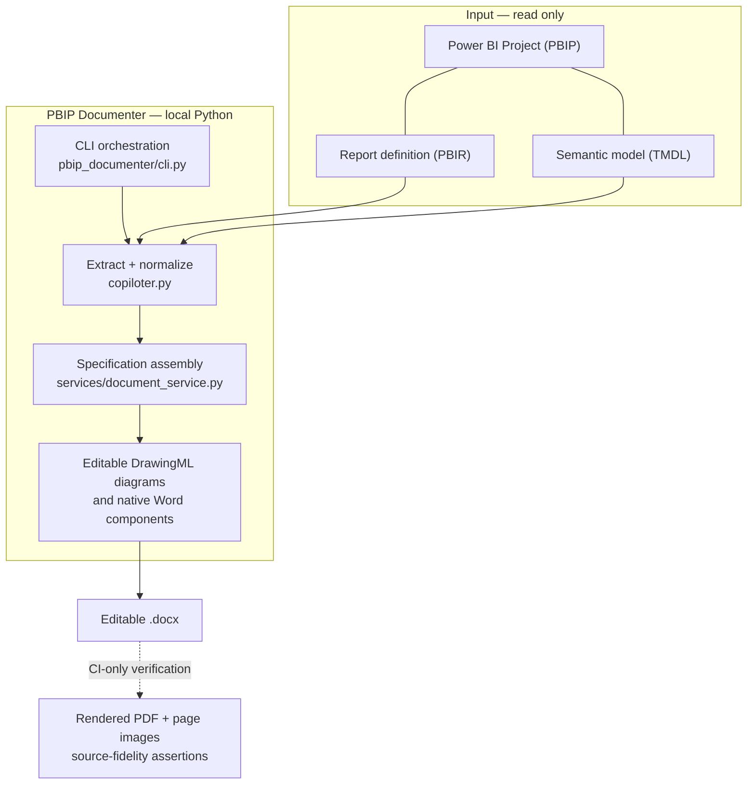
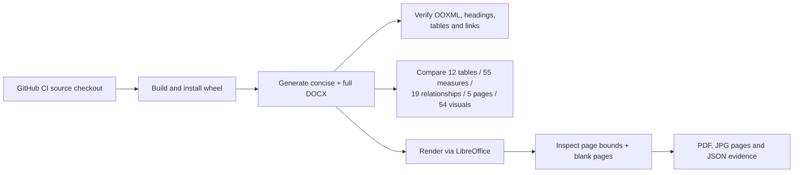

# Architecture & trust boundaries

[← Repository overview](../README.md) · [Use with an AI agent](AGENT_WORKFLOW.md) · [Source-verified output](EXAMPLES.md)

**Design intent:** convert local Power BI project metadata into an editable, source-grounded Word specification. Documentation is the product. Report repair, agent orchestration and tenant inventory are optional surrounding workflows, not dependencies of DOCX generation.

## Core path — small by design

The diagram reflects concrete code paths in the current repository; it does not imply a cloud service, database or persistent agent platform.

## Component map

| Layer | Location | Why it exists |
| :--- | :--- | :--- |
| Entrypoint | [`bootstrap.py`](../pbip_documenter/bootstrap.py) | Keeps installed console startup thin |
| CLI / output selection | [`cli.py`](../pbip_documenter/cli.py) | Selects projects, default/full mode, template and destination |
| Source extraction | [`copiloter.py`](../copiloter.py) | Builds a normalized PBIP report/semantic-model summary |
| Analysis | [`analysis/`](../pbip_documenter/analysis/) | Sources, DAX patterns, observations, diagrams and lineage helpers |
| Document assembly | [`document_service.py`](../pbip_documenter/services/document_service.py) | Coordinates narrative structure and source-derived sections |
| Word presentation | [`docx_render/`](../pbip_documenter/docx_render/) | Native Word styles, tables, navigation, pagination hints and wireframes |
| Acceptance | [`ci.yml`](../.github/workflows/ci.yml) | Validates installed CLI, generation and source-to-DOCX consistency |

## Native Word diagrams ? not static images

**A core differentiator:** the diagrams are **constructed programmatically from actual PBIP metadata** and written as **grouped Word DrawingML objects**. [\`diagrams.py\`](../pbip_documenter/docx_render/diagrams.py) builds \`wpg:wgp\` groups containing \`wps:wsp\` shapes, text boxes and connector definitions. This differs fundamentally from generating a screenshot/PNG and inserting it into a Word page.

| Diagram | Source and dynamic generation | Word representation |
| :-- | :-- | :-- |
| **Semantic-model relationships** | [\`schema.py\`](../pbip_documenter/analysis/schema.py) selects connected tables and relationships, computes focus layouts, then creates actual nodes and attached connectors | Native grouped DrawingML shapes and relationship lines |
| **End-to-end data lineage** | [\`lineage.py\`](../pbip_documenter/analysis/lineage.py) traces data sources, staging queries, loaded tables and report-page usage where discoverable | Native Word shapes, labels and connectors |
| **Report-page wireframes** | [\`wireframe.py\`](../pbip_documenter/docx_render/wireframe.py) derives visual zones, types and proportional layouts from PBIR geometry | Native Word shapes and text, not a pasted page capture |

**Editable means the diagram consists of Word drawing objects.** Users can modify their shapes/text/position in a compatible Word editor (some edits may require selecting or ungrouping objects). **Dynamic means regenerated when the generator is run again.** It does *not* mean live data interaction, automatic syncing from the PBIP after document creation, or a live Power BI dashboard.

The public [full Contoso DOCX](samples/Contoso-Retail-full.docx) currently contains **10 grouped diagrams, 266 native Word shape elements and 78 connector endpoint pairs**, and no embedded media files. [Installed-wheel generation CI](../scripts/ci_docx_generation_smoke.py) checks diagram structures so this feature cannot quietly regress to flattened images.

The README's JPG/PNG illustrations are *previews made by PDF-rendering the Word document*. The **DOCX itself retains native shapes**. The wireframe conveys visual types and bindings, not live dataset values or pixel-identical report renders.

## Acceptance flow

For the public fictional Contoso project, the [source-fidelity script](../scripts/ci_docx_render_acceptance.py) compares **exact inventory members** (not only counts) for tables, measures and relationships, plus report pages and visual totals. It also checks basic PDF rendering geometry. The [generation script](../scripts/ci_docx_generation_smoke.py) runs the **installed wheel**, not just a source-tree import.

### What CI does not establish

- A successful DOCX render is **not** a Microsoft Word layout certification. Word pagination can differ from LibreOffice.
- Source parsing does not establish **business purpose, excluded capabilities, owner identity, tenant-level permissions or SLA** unless explicit trusted information is supplied.
- Layout wireframes are **not screenshots of Power BI Desktop**.
- The sample passing does not prove that all possible PBIP/PBIR versions or custom visuals are supported.

This keeps documentation claims proportionate to available evidence.

## Privacy and safe execution

- The primary path operates against **local PBIP files**; it does not rewrite the source. The default output goes under the user's working directory.
- User-supplied templates and logos are explicit options. Optional Power BI/Jira inventory data requires separately configured dependencies and credentials; see [inventory](INVENTORY.md).
- Public test data must be synthetic. Never upload customer PBIP sources, credentials, downloaded caches or generated client DOCX artifacts into the repository.
- [VQS](VQS_OPTIONAL.md) may inspect/repair reports when separately requested. Neither VQS nor Power BI Desktop is required for the Word generator.

## Generated-output documentation

The [gallery](EXAMPLES.md) is sourced from actual DOCX PDF rendering in [successful main CI](https://github.com/analienx/pbidocumenter/actions/runs/40870433647). Each screenshot is mapped to its source Word file and original PDF page in [the provenance manifest](images/showcase-provenance.json). This prevents attractive but disconnected mock screenshots from becoming misleading documentation.
