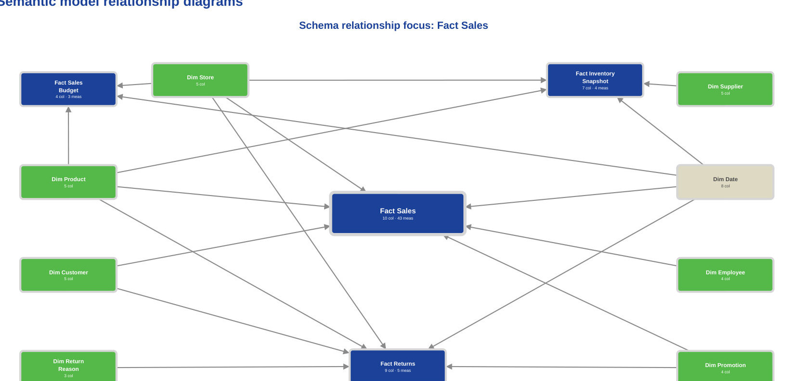
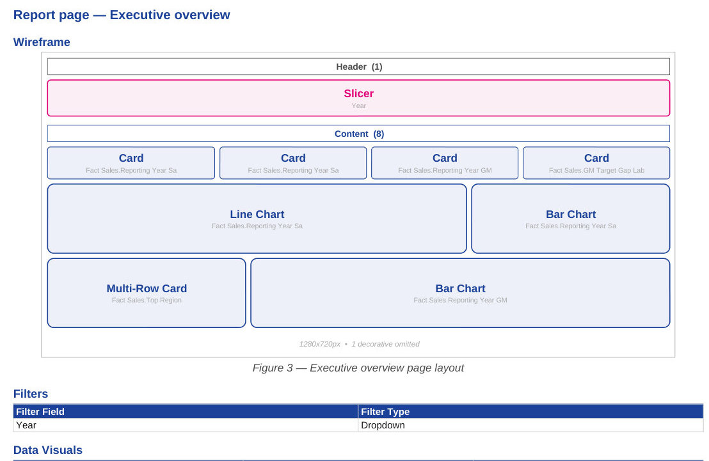
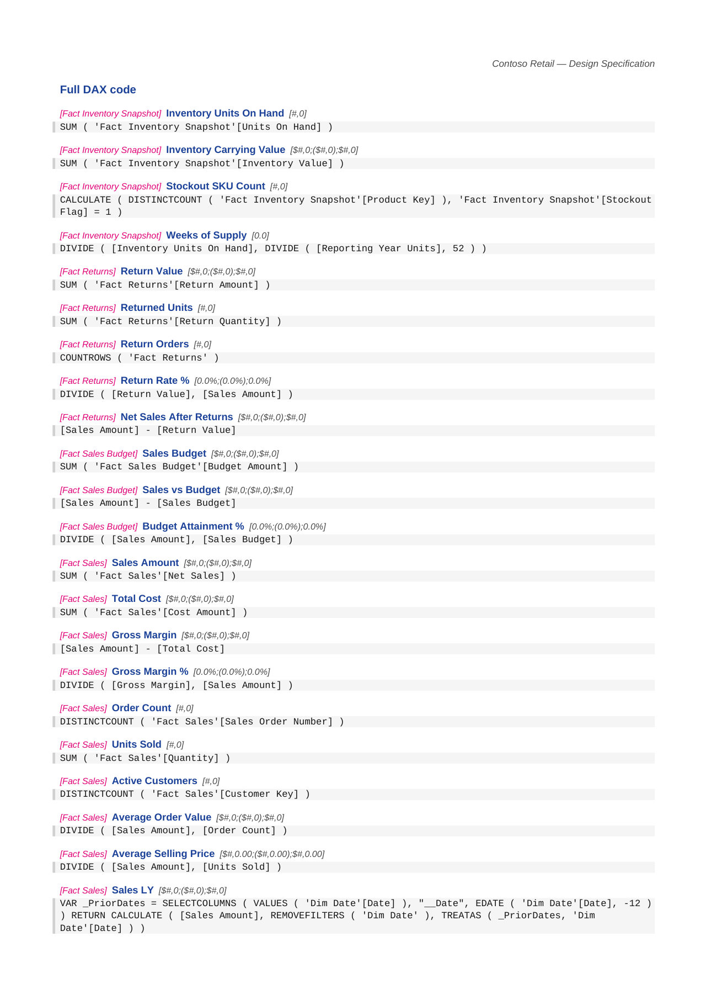
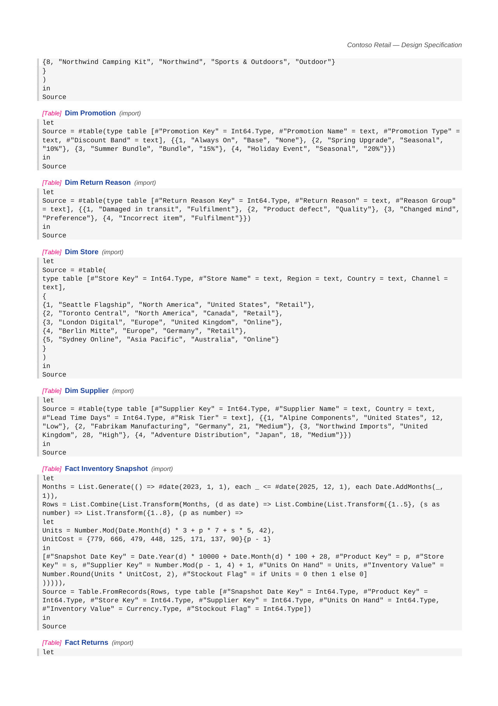
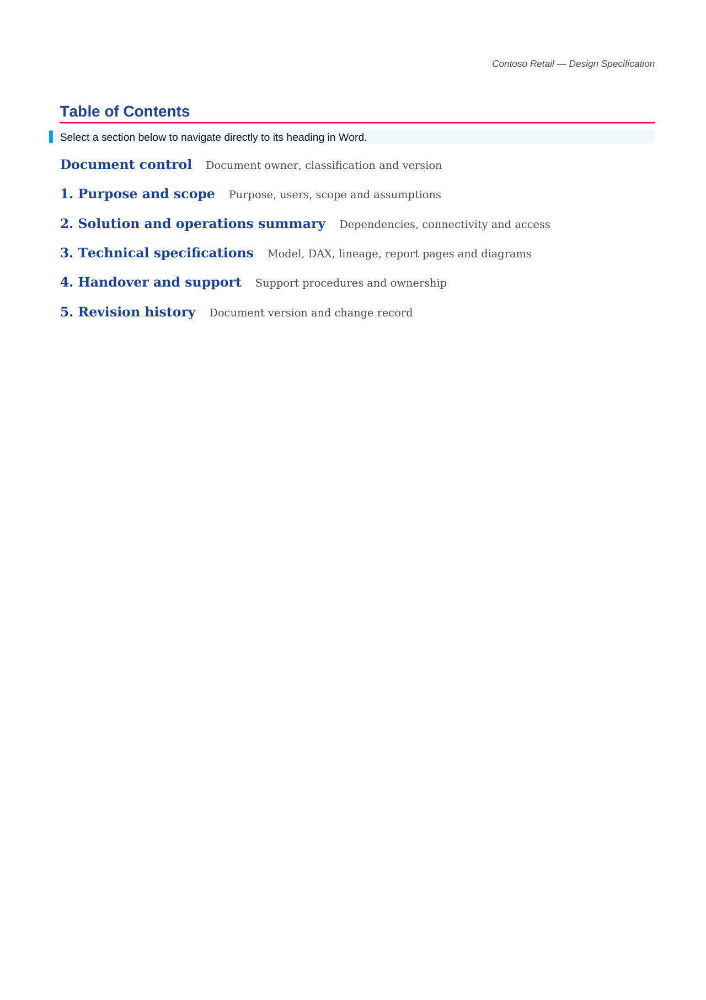
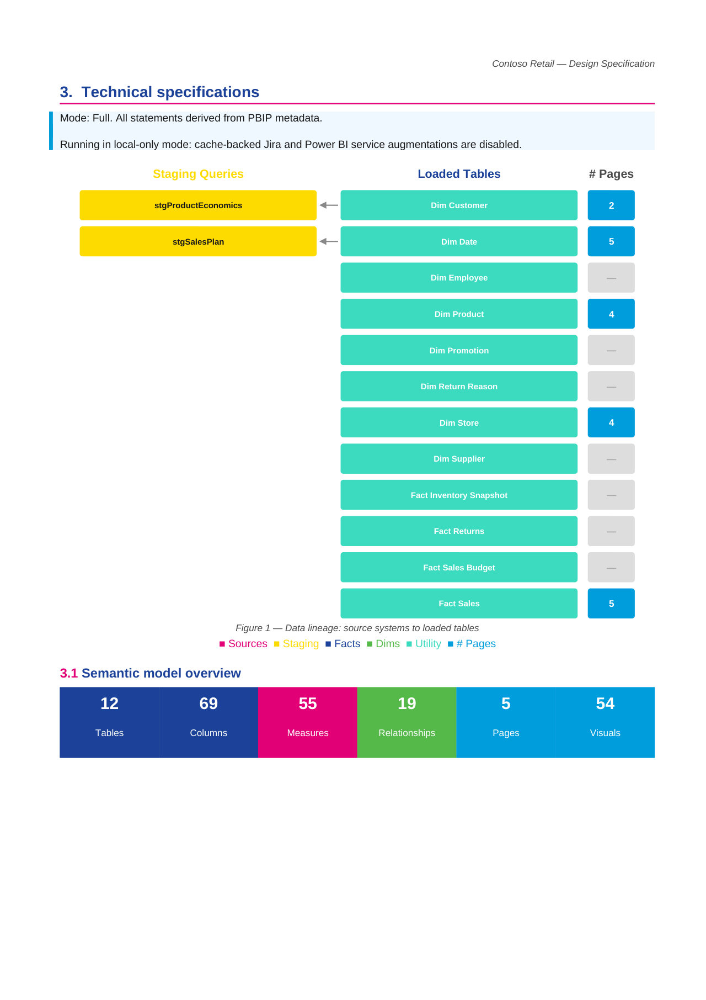

# Inside a real generated specification

[← Overview](../README.md) · [Download sample files](samples/README.md) · [How it works](ARCHITECTURE.md)

**One fictional Power BI project. Two editable Word specifications. Diagrams generated as native Word drawing objects ? not pictures.** All examples on this page come from the Contoso Retail PBIP bundled in the repository—not hand-built demonstration pages.

| Open the result | Get the editable Word document |
| :-- | :-- |
| **[Browse the 27-page full document as PDF](samples/Contoso-Retail-full.pdf)** | **[Full specification (.docx)](samples/Contoso-Retail-full.docx)** |
| 18-page concise Word version | [Concise specification (.docx)](samples/Contoso-Retail-concise.docx) |

**Relationship positioning matters:** view the [native Word before/after comparison](SCHEMA_LAYOUT_QUALITY.md) to see the crossing-aware layout, with model-size simulations and real Microsoft Word exports.

## 01 / Understand the data model

*GitHub preview cropped from an actual document render. In the DOCX, the relationship diagram consists of native editable DrawingML shapes and connectors, not this JPEG. [View the original full page](images/showcase/model-lineage.jpg).*

The document describes semantic-model structure and relationships. It doesn't invent table definitions or ask you to reconstruct the model manually.

## 02 / Understand every report page

*GitHub preview cropped from an actual document render. In Word, the wireframe consists of editable DrawingML shapes built from PBIR page geometry. [View the full page with visual bindings and filters](images/showcase/report-wireframe.jpg). It is not a screenshot of a live Power BI dashboard.*

### What makes these diagrams different?

**Source-driven generation:** on each invocation, PBIP Documenter recalculates model, lineage and page-layout diagrams from the current project. **Native Word output:** the public example's DOCX has 10 grouped diagrams, 266 shape elements and 78 connector endpoint pairs; no image files are embedded. **Editable, not live-synced:** you can adjust the Word drawing objects; rerun the generator to reflect later PBIP changes. [Inspect the real DOCX](samples/Contoso-Retail-full.docx) or [the implementation](ARCHITECTURE.md#native-word-diagrams--not-static-images).

## 03 / See the engineering detail

| DAX calculations | Power Query / M |
| :--: | :--: |
|  |  |
| Source expressions, not generated pseudocode | Extracted M transformation details |

The **full** mode provides deeper formulas and technical inventories; the **concise** mode prioritizes orientation and handover.

## 04 / Handover-ready structure

| Navigation and document hierarchy | Model overview and key counts |
| :--: | :--: |
|  |  |

The result also includes [categorized technical observations](images/showcase/technical-observations.jpg). Anything that requires business context—owner, operational SLA, user intent or classification—is left for confirmation rather than asserted as a source fact.

## Verified against the original PBIP

| Inventory | Exact source-to-document verification |
| :-- | --: |
| Tables | **12 of 12** |
| Measures, including owning tables | **55 of 55** |
| Relationship endpoints | **19 of 19** |
| Report pages | **5 of 5** |
| Report visual totals | **54 of 54** |

The [successful GitHub CI run](https://github.com/analienx/pbidocumenter/actions/runs/41021358575) produced the actual DOCX files, rendered the PDFs and checked the inventories against source. The concise version rendered to **18 pages**, the full version to **27 pages**, with no detected text blocks outside page bounds in that run. Those are test results for this fixture, **not universal document-length or design guarantees**.

### Where these images came from

- **Source:** [public fictional Contoso Retail PBIP](../examples/contoso-retail/)
- **Generated document:** installed-wheel output from CI run `41021358575` (commit `750cedc`)
- **Screenshots:** full PDF pages from LibreOffice; hero and detail images are explicitly labeled compositions/crops of those actual pages
- **Traceability:** [image hashes and page provenance](images/showcase-provenance.json) · [sample SHA-256 checksums](samples/README.md)
- **Limitation:** LibreOffice verifies repeatable PDF rendering, but Microsoft Word may paginate differently. Final business and Word-layout approval remains a human decision.

[← Back to the product](../README.md) · [Agent workflow](AGENT_WORKFLOW.md) · [Source fidelity and architecture](ARCHITECTURE.md)
