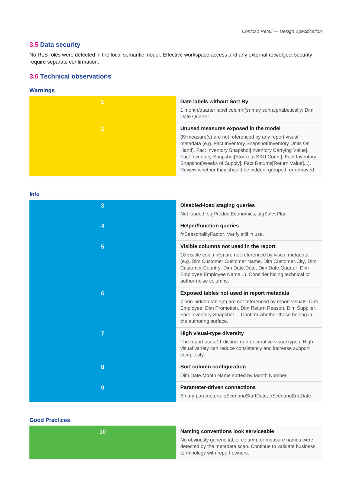

# Real output gallery

[← Back to PBIP Documenter](../README.md) · [CLI reference](CLI.md) · [Agent workflow](AGENT_WORKFLOW.md)

Every capture below is from the **actual Word design specification generated from the public [Contoso Retail PBIP project](../examples/contoso-retail)**. GitHub Actions generated the DOCX using the installed package, rendered it with LibreOffice, and ran source-fidelity checks. They are not hand-designed substitutes or Power BI Desktop screenshots.

> **Source of truth:** [successful `main` workflow 40870433647](https://github.com/analienx/pbidocumenter/actions/runs/40870433647) at commit [`ac6700c`](https://github.com/analienx/pbidocumenter/commit/ac6700c5d2c6adafcb784b2db4416c4d9fe99c9a). Each image's DOCX mode, PDF page number and SHA-256 are recorded in [`showcase-provenance.json`](images/showcase-provenance.json). Click any screenshot to see its full resolution.

## Overview

| Linked contents — generated output | Semantic model — generated inventory |
| :---: | :---: |
| [](images/showcase/contents.jpg) | [](images/showcase/semantic-model.jpg) |
| *A useful contents page without manually updating a Word field* | *The technical specification begins with source-derived facts* |

## The sections that matter to engineers

### 1. Model relationships and lineage

[](images/showcase/model-lineage.jpg)

The generated diagram summarizes semantic-model relationships. It is a diagram *of the source metadata*, not a screenshot of Power BI Desktop's relationship view.

### 2. DAX measures — full mode

[](images/showcase/dax-measures.jpg)

The **full** mode includes formula-level documentation, in addition to the measure inventory. This page shows the source-measure definitions rather than placeholder pseudocode.

### 3. Power Query / M — full mode

[](images/showcase/power-query.jpg)

Transformation-source coverage helps a future maintainer identify where data preparation lives. The source project is fictional; no private connection strings or customer data are showcased.

### 4. Report structure — wireframe and bindings

[](images/showcase/report-wireframe.jpg)

**Important:** this is a **generated PBIR wireframe**, deliberately abstracting the original report's layout and visual types. It is not a pixel-identical live dashboard render.

### 5. Technical observations

[](images/showcase/technical-observations.jpg)

The document distinguishes observations from business decisions. Report owners should verify suggested operational conclusions, support contacts and scope statements before treating the document as formally approved.

## What was independently checked

| Source inventory | Verified in concise and full DOCX |
| :--- | ---: |
| Semantic-model tables | **12 / 12** |
| DAX measures and owning tables | **55 / 55** |
| Relationship endpoints | **19 / 19** |
| Report pages | **5 / 5** |
| Visual totals from the pages | **54 / 54** |

The [GitHub Actions acceptance job](../.github/workflows/ci.yml) also renders **every page**, checks for completely blank pages, detects text bounds outside page geometry, and uploads PDF/JPEG evidence. In this run the concise output was **18 pages** and the full output **27 pages**, with no detected out-of-page blocks. Those page counts describe the sample, not a promise for arbitrary reports.

**Rendering fidelity boundary:** LibreOffice/PDF is a repeatable visual verification environment. Microsoft Word can break pages differently; review Word-specific pagination when it matters.

## Reproduce this gallery

From a checkout of the corresponding source revision:

```bash
# Download the GitHub-hosted rendered Word/PDF evidence
gh run download 40870433647 -R analienx/pbidocumenter \
  --name contoso-rendered-word-review-evidence \
  --dir /path/to/contoso-render-evidence

# Only the screenshot-generation script needs these image libraries
python -m pip install Pillow pymupdf

python scripts/build_readme_showcase.py \
  --evidence-dir /path/to/contoso-render-evidence \
  --run-id 40870433647 \
  --source-commit ac6700c5d2c6adafcb784b2db4416c4d9fe99c9a
```

The GitHub-hosted build artifacts have limited retention; the **committed screenshots and provenance manifest remain in the repository**. Regenerate screenshots whenever the documented fixture, output renderer or layout changes. Do not mix screenshots from different revisions while presenting them as one run.

[Image provenance and regeneration policy](images/README.md) · [Technical architecture](ARCHITECTURE.md) · [Main README](../README.md)
