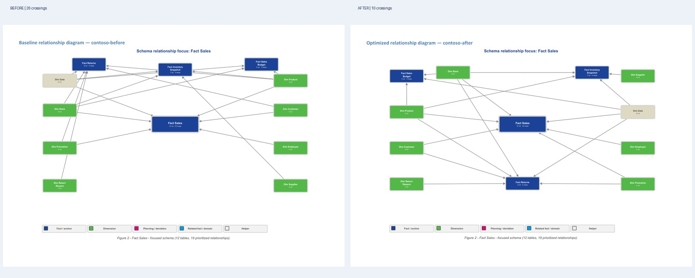

# Relationship layout quality

This document describes the **schema relationship positioning** of native Word DrawingML diagrams. It is a rendering-quality feature, not a change to Power BI source data or to the underlying relationships.

## What changed

The previous placement used an alternating left/right list of dimensions, top/bottom slices of other tables and a basic vertical overlap nudge. In dense models, boxes could collide, leave the diagram canvas or force connectors through unrelated tables.

The replacement in [`schema_layout.py`](../pbip_documenter/analysis/schema_layout.py) constructs a bounded set of safe slots in the existing landscape diagram. It then assigns nodes using deterministic, role-aware restarts and best-improvement swaps. Search depth adapts to diagram size: twelve restarts for compact layouts, four for dense views to avoid unnecessary generation latency. **Every candidate is evaluated with connector endpoints at actual node edges**, using box-overlap, connector-through-node, crossing and out-of-bounds penalties plus smaller penalties for edge length and role mismatches.

**Safe fallback:** The historical algorithm is evaluated for every diagram. The new arrangement is accepted only when its cost improves by both an absolute minimum of 2 points or a relative minimum of 3%; otherwise the original placement remains. Coordinates do not alter nodes, relationships, DrawingML object types or the document canvas size.

## Actual Microsoft Word before/after capture

*The two halves are genuine page captures from Microsoft Word's PDF export on the authorized Windows device. The model relationships and node contents are source-derived; only layout changes. The original Contoso focus had 26 connector crossings and 4 connector-through-node hits; the second search pass has 10 crossings and 0 connector-through-node hits, with no node overlaps. This is an illustrative test result for Contoso, not a guarantee that every semantic model is planar or crossing-free.*

## Tested model scales

The [comparison script](../scripts/schema_layout_comparison.py) simulates deterministic models of **6, 14, 48 and 160 total tables**, and separately tests the **actual public Contoso Retail PBIP project**. Large project diagrams intentionally display a maximum of 20 explicit tables per focus diagram and summarize the hidden remainder. A 160-table project is not presented as one 160-node hairball.

The script saves a **before and after native Word document for each case** along with comparable JSON geometry metrics. The [GitHub-hosted workflow](../.github/workflows/schema-layout-review.yml) renders those documents with LibreOffice to PDF and JPEG, publishes a side-by-side contact sheet and validates page geometry. The [regression tests](../pbip_documenter/tests/test_schema_layout.py) prevent overlaps and out-of-page placements in those synthetic focused views and check crossing reduction in Contoso.

**Rendering boundaries:** PDF/JPEG evidence is output of an actual document renderer, not a conceptual graph. Microsoft Word may position elements differently from LibreOffice; local Microsoft Word COM exports may be used as an additional visual review. The source fixture is fictional and does not certify the algorithm for every custom semantic model.

## Maintainability and rollback

Only node center placement is modified. The [native DrawingML renderer](../pbip_documenter/docx_render/diagrams.py), relationship identities, attached connectors and diagram legends continue to work as before. Disable the optimization by switching `_build_layout` back to `_build_layout_legacy`; no report migration or document schema transformation is required.

The comparison scripts and CI checks are intentionally independent of VQS.